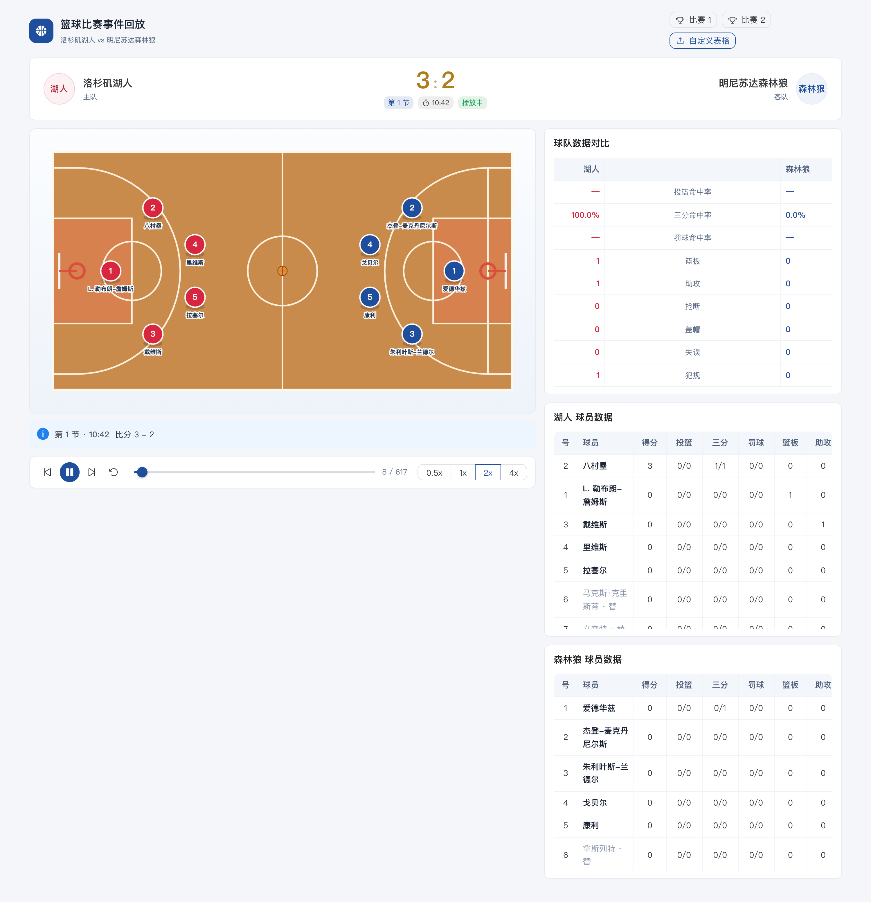

# FZU-OOP-OOAD

福州大学 2025 面向对象课设：读一张 XLSX 文字直播表，把比赛按事件一条条在 2D 球场上放出来。Vite + TypeScript + Vue 3 + Naive UI + PixiJS。



`main` 分支是课设原版，这个分支是把原版按分层重写了一遍的结果。

## 快速开始

```bash
npm install
npm run dev      # http://localhost:3000
npm run build    # 产物在 dist/，构建前会先跑 vue-tsc
npm run preview
npm test
```

Node 22+。浏览器需要 WebGL（PixiJS 用它画球场）。

## 用法

| 操作 | 说明 |
| --- | --- |
| 播放 / 暂停 | 按钮或空格 |
| 上一步 / 下一步 | 按钮或 ← → |
| 拖进度条 | 跳到任意事件，比分和统计按重放结果重算 |
| 0.5x ~ 4x | 播放速度 |
| 比赛 1 / 比赛 2 | 仓库自带数据，两份是同一份文字直播、队名不同 |
| 自定义表格 | 上传本地 XLSX，格式见下 |

## 数据格式

四张工作表 `c1`~`c4` 对应四节。第 2 行第 2、4 列是两队队名，第 3 行起每行四列：

| 时间 | 主队动作 | 比分 | 客队动作 |
| --- | --- | --- | --- |
| 11:45 | 八村塁 三分投篮： 命中(3 分) (戴维斯 1 次助攻) | 3-0 | |
| 11:30 | | 3-2 | 爱德华兹 突破上篮： 命中(2 分) |

时间列写 `MM:SS` 或 `HH:MM:SS` 都行。动作列认跳球、投篮、罚球、篮板、犯规、盖帽、抢断、失误、换人、暂停、违例、节次开始结束；认不出来的行直接丢掉，不会造出错数据。

## 项目结构

```
src/
├── domain/          纯规则：技术统计、球员、球队、时钟、事件子类、比赛聚合
├── application/     用例：文字解析规则、事件工厂、比赛装配、播放器、读模型、端口
├── infrastructure/  适配器：xlsx 读取、浏览器计时器
├── ui/              Vue 组件 + Pixi 球场渲染
├── app/             组合根：具体实现只在这里 new
└── main.ts          挂载
```

依赖单向：`ui → application → domain`，`infrastructure` 实现 `application/ports` 里的接口。

## 测试

```bash
npm test        # 46 个用例
npm run test:watch
```

覆盖统计值对象、事件应用、文字规则、比赛装配、播放器（注入假计时器，不真等一秒）、两份真实 xlsx 回归，以及一条卡 import 方向的分层测试。

## 已知问题

- 球员「投篮」列不含三分，跟原版一致；球队得分以表格「比分」列为准，个人得分由各人命中累加，两者不一定严格相等（原始数据本身就缺行）。
- 换人只播提示，场上五人固定为首发。
- 打包 1.3 MB（Pixi + Naive UI），没做代码分割。
- 只认四节制的表格，加减一节或者换了列顺序就读不了。

设计说明见 [docs/DESIGN.md](docs/DESIGN.md)。

## 致谢

[PixiJS](https://pixijs.com/)、[Naive UI](https://www.naiveui.com/)、[SheetJS](https://sheetjs.com/)、[Phosphor Icons](https://phosphoricons.com/)。

## License

MIT，见 [LICENSE](LICENSE)。
